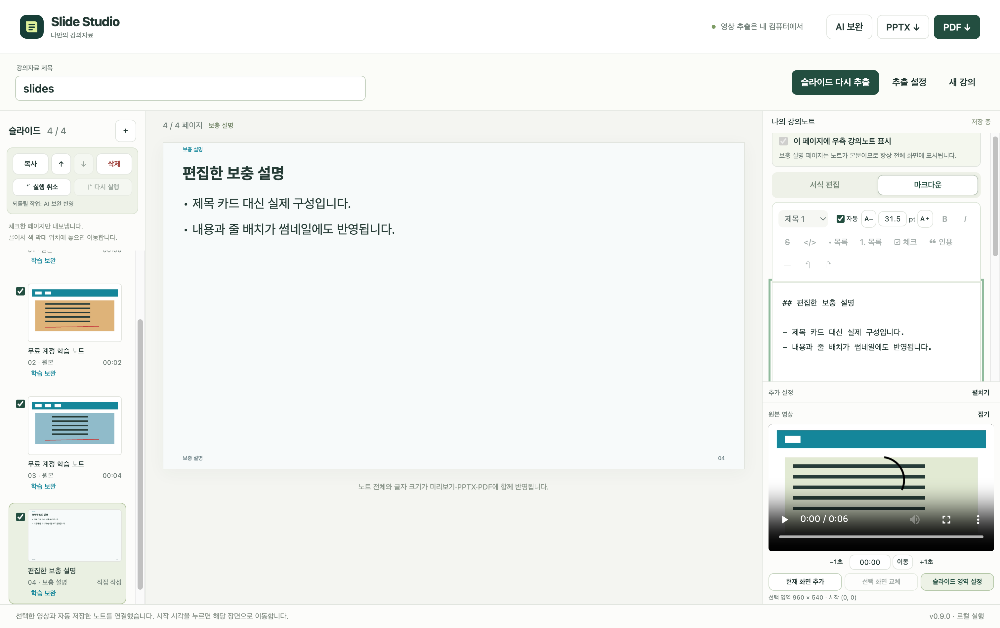
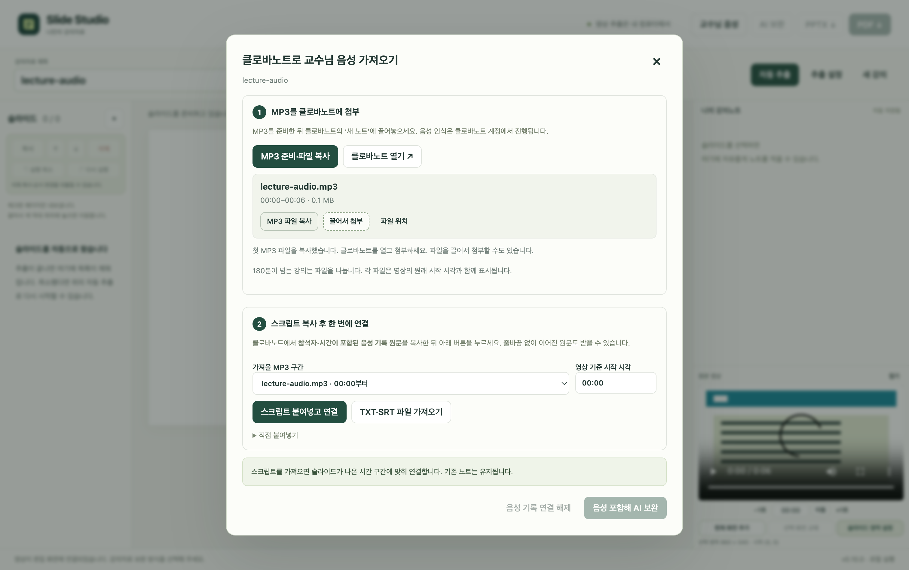
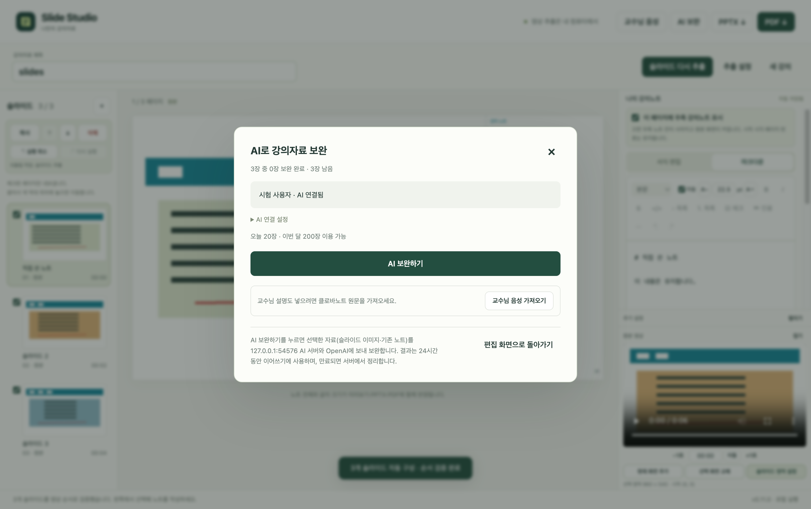

# Slide Studio

강의 영상을 열면 원본 슬라이드와 필기 화면을 자동으로 찾고, 하나의 문서 편집기에서 쓴 노트를 PPTX·PDF로 내보내는 **Windows·macOS용 로컬 앱**입니다.

**영상 추출·편집·내보내기와 MP3 준비는 로컬에서 실행합니다.** AI 보완은 운영자가 제공한 초대 코드로 처음 한 번 연결한 뒤 **AI 보완하기**를 누르면 됩니다. 클로바노트에서 만든 시간 포함 음성 원문을 가져오면 교수님 설명도 함께 정리합니다. 일반 사용자는 ChatGPT 계정이나 API 키가 필요하지 않으며, Chrome, Node.js, Python, FFmpeg, Codex를 별도로 설치하지 않아도 됩니다. AI 보완과 클로바노트 이용에는 인터넷이 필요합니다.

현재 소스 버전은 **v0.11.0 개발판**입니다. 운영자 API를 사용하는 보완 기능을 준비하고 있으며, 공개 설치 파일은 아직 **v0.10.2**입니다. 아래 다운로드에는 이전 AI 사용 방식이 표시됩니다. 새 AI 기능은 서버 설정·실제 API 연결 확인과 세 플랫폼 검사를 마친 뒤 배포합니다. 운영자 설정은 [AI 서버 시작 안내](server/README.md)를 참고하세요.

## 다운로드와 설치

| 컴퓨터 | 다운로드 | 설치 |
| --- | --- | --- |
| Windows PC · x64 | [Windows 설치 파일](https://github.com/t09n0tch/slide-studio/releases/latest/download/SlideStudio-Windows-x64-Setup.exe) | Setup.exe를 실행합니다. |
| Mac · Apple Silicon / M 시리즈 | [Apple Silicon용 DMG](https://github.com/t09n0tch/slide-studio/releases/latest/download/SlideStudio-macOS-arm64.dmg) | DMG를 열고 앱을 Applications로 드래그합니다. |
| Mac · Intel | [Intel용 DMG](https://github.com/t09n0tch/slide-studio/releases/latest/download/SlideStudio-macOS-x64.dmg) | DMG를 열고 앱을 Applications로 드래그합니다. |

[모든 릴리스와 SHA-256 확인](https://github.com/t09n0tch/slide-studio/releases/latest) · [버전별 변경 사항](RELEASE_NOTES.md)

**기존 사용자 업데이트:** 실행 중인 앱을 종료하고 새 Windows Setup.exe를 같은 경로에 설치하거나, Mac 앱을 Applications에서 교체합니다. 앱 데이터 폴더는 설치 파일과 분리되어 있어 자동 저장한 노트를 유지합니다. 이어서 작업하려면 같은 원본 영상을 다시 선택하세요.

현재 배포본은 정식 개발자 인증서 서명과 Apple 공증을 받지 않았습니다. 첫 실행 확인이나 차단이 표시될 수 있습니다. Mac은 [Apple의 확인 방법](https://support.apple.com/ko-kr/102445)을 참고하세요. 소스 코드 ZIP은 설치 파일이 아닙니다.

Mac 개발판에서 AI를 연결하거나 업데이트하면 연결 정보 암호화를 위해 키체인 접근 확인이 표시될 수 있습니다. 본인이 설치한 Slide Studio인지 확인해 macOS 창에서 응답하세요. 암호화 처리는 비동기로 실행하며, 저장소가 일시적으로 잠긴 경우 연결 정보를 지우지 않고 다시 시도할 수 있습니다. [Electron의 키체인·코드 서명 안내](https://www.electronjs.org/docs/latest/api/safe-storage)

## 편집 화면



테스트용 영상과 노트로 구성한 화면입니다.

## 사용하기

1. 설치한 **Slide Studio**를 실행합니다.
2. 첫 화면에는 큰 **slide studio** 제목과 파일을 넣는 영역이 나옵니다.
3. 첫 화면 중앙에 영상을 놓거나 클릭해 선택합니다. AI를 쓰려면 처음 한 번 **AI 연결 설정**에 운영자의 초대 코드를 입력하고 **추출하고 AI 보완하기**를 누릅니다. **보완 없이 슬라이드만 추출**로 로컬 추출만 진행할 수도 있습니다.
4. 진행 창의 **0–100%**와 옆에 작게 표시되는 **예상 남은 시간**을 확인하며 기다립니다. 처음에는 ‘남은 시간 계산 중’으로 표시하고, 약 2초 후부터 경과 시간과 진행률로 추정한 시간을 갱신합니다. 처리 단계와 컴퓨터 속도에 따라 예상 시간이 달라질 수 있습니다. 완료 후 왼쪽 슬라이드를 선택합니다. 하단 원본 영상도 바로 재생할 수 있습니다.
5. 오른쪽 **나의 강의노트**에 자유롭게 씁니다. 제목과 본문을 별도 칸에 나눠 입력하지 않습니다. 툴바로 서식을 고르면 마크다운 문법을 몰라도 쓸 수 있습니다.
6. **PPTX ↓ / PDF ↓**로 완성본을 내보냅니다. 파일은 컴퓨터의 **다운로드 폴더**에 저장됩니다. 같은 이름이 있으면 번호를 붙여 기존 파일을 보관합니다.

개발판 편집 화면 하단의 버전은 **v0.11.0**입니다. 앱 창을 뒤로 보내도 추출이 이어집니다. 제목은 상단의 입력 창에서 수정합니다.

## 클로바노트로 교수님 설명 가져오기

1. 강의 영상을 연 뒤 **교수님 음성**을 누릅니다. 처음 보완 방식을 고르는 화면에서도 열 수 있습니다.
2. **MP3 준비·파일 복사**를 누릅니다. 진행률과 예상 남은 시간을 표시하며, 준비한 MP3는 실제 파일 형식으로 클립보드에 복사합니다.
3. **클로바노트 열기**로 새 노트를 만들고 MP3를 첨부합니다. 앱의 **끌어서 첨부**를 잡고 클로바노트 파일 첨부 영역에 놓을 수 있습니다. 파일 선택이 필요하면 **파일 위치**를 엽니다. 클로바노트의 Ctrl/⌘+V 파일 첨부 지원은 확인하지 않았으므로 드래그 또는 파일 선택을 사용할 수 있게 제공합니다.
4. 인식이 끝나면 요약문 대신 **참석자와 시간이 포함된 음성 기록 원문** 전체를 복사합니다. 앱으로 돌아와 **스크립트 붙여넣고 연결**을 누릅니다. TXT·SRT·VTT 파일 선택과 직접 붙여넣기도 가능합니다.
5. **음성 포함해 AI 보완 → AI 보완하기**를 누릅니다. 해당 시간대 교수님 설명을 슬라이드별로 연결해 이미지·기존 노트와 함께 보내고, 우측 노트와 필요한 보충 설명을 자동으로 배치합니다.



테스트용 영상으로 확인한 실제 앱 화면입니다.

아래처럼 **줄바꿈 없이 이어진 원문**도 가져옵니다. 음성 기록을 슬라이드 추출 전에 연결해도 됩니다.

```text
참석자 1 00:00 첫 번째 설명입니다.  참석자 1 00:35 다음 설명입니다.
```

클로바노트는 [MP3 업로드·드래그 첨부](https://help.naver.com/service/24269/contents/12820?osType=PC)를 지원하며, [파일당 최대 180분](https://help.naver.com/service/24269/contents/12814?osType=COMMONOS)까지 변환합니다. 앱은 긴 강의를 180분보다 짧게 나누고 파일별 **원본 영상의 시작 시각**을 표시합니다. 각 파일의 원문을 하나씩 가져오면 시작 시각을 자동으로 더합니다. 클로바노트 계정의 변환 시간 한도는 그대로 적용됩니다.

MP3는 다운로드 폴더에 남기지 않고 앱의 임시 공간에 만듭니다. 해당 파일의 스크립트를 반영하면 MP3를 지우고, 새 강의·앱 종료·다음 실행 시에도 남은 임시 파일을 정리합니다. 원본 영상은 보존합니다. 가져온 음성 원문은 슬라이드·노트와 함께 자동 저장하고, 연결·수정·해제를 실행 취소할 수 있습니다. 원문 연결만으로 기존 노트가 바뀌지는 않습니다.

슬라이드와 음성은 원본 영상의 시간 구간으로 연결하므로 페이지를 옮기거나 복사해도 유지됩니다. 클로바노트 시간은 단어별 시각이 아닌 문단의 시작 시각입니다. 슬라이드 전환에 걸친 문단은 양쪽의 참고 문맥으로 전달하며, AI에는 해당 슬라이드와 관련된 설명만 정리하도록 요청합니다. 음성 인식의 오탈자와 요약 결과는 원본과 대조해 확인하세요.

앱은 음성을 클로바노트에 자동 전송하거나 클로바노트 계정으로 로그인하지 않습니다. 사용자가 브라우저에서 첨부하고, 음성 인식은 클로바노트에서 진행합니다. 앱 내부의 음성 인식 모델이나 STT API 키는 사용하지 않습니다.

## AI로 노트와 보충 설명 만들기

1. 운영자가 전달한 초대 코드를 **AI 연결 설정**에 한 번 입력합니다. 서버 주소도 코드에 들어 있으므로 별도로 설정할 필요가 없습니다.
2. **AI 보완하기**를 누릅니다. 슬라이드를 최대 4장씩 처리해 우측 노트와 필요한 보충 설명 페이지를 자동으로 추가합니다.
3. 결과를 확인하고 PPTX·PDF로 내보냅니다. 직접 작성한 노트는 보존하며, 보완을 실행 취소할 수도 있습니다.



실제 앱·로컬 HTTP 서버를 연결한 검사 화면이며, 모델 답변은 테스트용입니다. 현재 ChatGPT 로그인과 무료 계정 복사·붙여넣기 메뉴는 제거했습니다. 기존 버전에서 만든 노트는 유지됩니다.

AI 비용은 운영자의 OpenAI API 프로젝트에 청구됩니다. 사용자별·전체 일간/월간 슬라이드 한도에 도달하면 중단하고 이미 완료한 노트를 유지합니다. 취소하거나 연결이 끊겼다면 **이어서 AI 보완하기**로 같은 요청을 이어갑니다. 서버는 24시간 동안 결과를 다시 전달할 수 있으며, 이미 처리한 요청을 자동으로 재호출하지 않습니다. 보관 기간이 끝났거나 서버가 결과를 확정하지 못한 요청은 새 요청을 시작하기 전에 안내합니다.

선택한 슬라이드 이미지와 슬라이드당 최대 3,000자의 기존 노트를 운영자 서버와 OpenAI에 보냅니다. 클로바노트 원문이 있으면 해당 시간대 텍스트도 함께 보냅니다. 원본 영상·MP3 파일은 AI 서버에 전송하지 않습니다. 원문이 없으면 이미지·기존 노트만으로 보완하며, 교수님의 실제 발언을 확인한 것으로 표시하지 않습니다. 작은 필기·화학구조·수식과 보완 설명은 원본과 대조해 검토하세요. AI가 반영한 페이지에는 **학습 보완** 표시가 붙습니다.

API 키는 운영자 서버의 환경 설정에만 보관하며 설치 앱·GitHub에 넣지 않습니다. 앱은 초대 연결 정보를 운영체제 `safeStorage`로 암호화해 `service/connection.enc`에 보관합니다. 서버는 입력 이미지·음성 원문을 데이터베이스에 저장하지 않습니다. 생성 결과는 24시간 이후 정리하고, 중복 호출 방지를 위한 요청 식별자·해시·사용 장수는 보관합니다. 운영 방법과 월 $30 설정은 [AI 서버 시작 안내](server/README.md)에 있습니다.

## 하나의 노트 편집기

- **본문 / 제목 1·2·3:** 툴바의 문단 스타일을 선택합니다.
- **굵게·기울임·취소선·코드:** 글자를 선택한 뒤 해당 버튼을 누릅니다. 굵게는 `⌘/Ctrl+B`, 기울임은 `⌘/Ctrl+I`도 지원합니다.
- **목록·번호 목록·체크리스트·인용·구분선:** 툴바 버튼으로 추가합니다. 체크박스는 편집기에서 직접 체크합니다.
- **노트 실행 취소·다시 실행:** 노트 툴바의 화살표를 사용합니다. 노트를 쓰는 중의 `⌘/Ctrl+Z`는 노트 편집에 적용됩니다.
- **마크다운:** `# 제목`, `**강조**`, `- 목록` 등을 입력할 수 있습니다. ‘마크다운’ 탭에서 원문을 편집하고 ‘서식 편집’으로 돌아올 수도 있습니다.
- **노트 불러오기:** `.md`·`.markdown` 파일은 마크다운으로, `.txt`는 일반 텍스트로 불러옵니다. 표·외부 이미지·HTML 문법은 실행하거나 불러오지 않고 텍스트로 보관합니다.
- **노트 글자 크기:** 서식 툴바 안의 **자동**이 기본으로 켜집니다. 전체 텍스트, 제목, 목록과 실제 출력 글꼴 너비를 계산해 한 페이지에 맞는 크기를 고릅니다. AI 답변을 처음 반영할 때도 적용합니다. 툴바의 숫자 입력과 A−·A＋로 페이지별 8~36pt를 선택하면 수동 크기로 바뀝니다. 미리보기·PPTX·PDF는 같은 글자 크기와 줄 배치를 사용합니다.
- **긴 노트:** 자동 맞춤은 이미지가 있는 페이지에서 최소 10pt, 설명 전용 페이지에서 최소 14pt를 사용합니다. 그래도 한 페이지를 넘으면 글을 보관하며 다음 페이지로 이어집니다. 미리보기 아래에 총 페이지 수를 안내합니다. 노트 라벨은 좌상단에 작게 표시합니다.
- **보충 설명:** 왼쪽 `＋`로 설명 전용 페이지를 추가할 수 있습니다. AI 보완 페이지를 포함한 설명 전용 페이지의 썸네일은 제목 카드 대신 실제 글꼴·본문·페이지 번호를 그립니다. 내용이나 글자 크기를 바꾸면 갱신하며 목록의 스크롤을 유지합니다.
- **글꼴과 간격:** 편집기·미리보기·PDF에 [Pretendard 1.3.9](https://github.com/orioncactus/pretendard/releases/tag/v1.3.9)를 함께 사용합니다. 기본 자간과 넉넉한 줄간격으로 맞추며 PDF에 글꼴을 포함합니다. PPTX도 Pretendard로 지정합니다. 포함 글꼴은 앱과 함께 오프라인으로 제공합니다.
- **고정 툴바:** 모드 선택과 서식·글자 크기 도구를 불투명한 한 영역으로 고정합니다. 노트를 스크롤해도 본문이 도구 사이로 비치지 않습니다.
- **추가 설정:** 우측 하단의 **추가 설정 → 펼치기**에서 페이지 종류와 발표자 노트를 수정합니다. **접기**로 공간을 줄이며 입력값은 유지됩니다.

노트의 서식을 내보내기에도 적용합니다. PPTX에서는 제목·본문·강조가 편집 가능한 텍스트로 들어가며, PDF에는 한글 보통·굵은 글꼴을 임베딩합니다. 원본 슬라이드·교수님 필기는 영상 해상도의 이미지로 보관합니다. AI 보완을 선택하면 학습 노트와 보완 설명을 함께 배치합니다.

## 페이지 표시·복사·실행 취소

- **페이지별 노트 표시:** 오른쪽 위의 **이 페이지에 우측 강의노트 표시**를 끄면, 선택한 페이지의 미리보기와 PPTX·PDF에서 노트 칸과 구분선이 사라집니다. 원본은 비율을 유지하며 크게 맞추고, 하단의 얇은 표시 공간에 시작 시각·페이지 번호를 유지합니다. 필기를 덮지 않으며 미리보기·PPTX·PDF에 동일하게 반영합니다. 다른 페이지의 표시 설정은 유지합니다.
- **숨긴 노트 보관:** 작성한 노트는 자동 저장하고 다시 켜면 표시합니다. 숨겨 둔 긴 노트 때문에 다음 페이지를 만들지 않습니다. PPTX에는 발표자 노트로 보관합니다. 이미지가 없는 보충 설명 페이지는 노트 자체가 본문이므로 전체 화면으로 표시합니다.
- **페이지 컨트롤:** 왼쪽 썸네일 위 컨트롤 박스에 **복사 / ↑ / ↓ / 삭제 / 실행 취소 / 다시 실행**을 모았습니다. 선택한 페이지에 적용합니다.
- **페이지 복사:** **복사**로 원본 이미지, 작성한 노트, 시작 시각, 표시 설정과 글자 크기를 복사해 바로 다음에 추가합니다. 복사본의 노트를 고쳐도 원본은 유지합니다.
- **드래그 이동:** 썸네일을 끌면 실제로 들어갈 슬라이드 사이에 주황색 막대가 표시됩니다. 각 썸네일의 위·아래 절반을 기준으로 앞·뒤 위치를 고릅니다. 제자리나 목록 밖에서는 막대를 숨기고 이동하지 않습니다. 목록 끝에서 잠시 유지하면 스크롤할 수 있습니다. 이동을 완료하면 끌어 옮긴 페이지가 선택되어 미리보기·노트·영상이 함께 맞춰집니다. 드래그를 취소하면 기존 선택을 유지합니다.
- **스크롤 유지:** 썸네일을 선택할 때 목록을 다시 만들지 않으므로 사용자가 맞춘 목록 스크롤을 유지합니다. 슬라이드 추가·삭제 등 목록 변경 시에도 기존 스크롤 위치를 유지합니다.
- **페이지 실행 취소·다시 실행:** 컨트롤 박스의 **실행 취소 / 다시 실행**을 사용합니다. 삭제·복사·화살표 이동·드래그 순서 변경·노트 표시·글자 크기·영상 영역 변경 등 최근 50번의 페이지 작업을 되돌릴 수 있습니다. 페이지 순서나 삭제를 되돌려도 다른 페이지에 이후 작성한 노트는 보존합니다. 앱을 다시 열면 작업 기록은 초기화되고 저장된 페이지는 유지합니다.
- **페이지 단축키:** 텍스트 입력 칸 밖에서 `⌘/Ctrl+Z`로 실행 취소, `⌘/Ctrl+Shift+Z`로 다시 실행합니다. Windows에서는 `Ctrl+Y`도 사용할 수 있습니다.

## 슬라이드 시간과 영상

목록과 미리보기, PPTX·PDF의 시간은 **해당 슬라이드가 처음 안정적으로 등장한 구간의 시작점**입니다. 반복해서 돌아온 슬라이드는 첫 구간을 기준으로 합니다. 처음·완성 화면으로 나눈 문제와 풀이도 원본 슬라이드의 시작점을 공유합니다.

슬라이드의 시간은 ‘시작’ 문구 없이 소수점 없는 **mm:ss**로 통일하며 1시간 이상은 분을 누적합니다. 내부 시작 시각은 원래 정밀도로 보관합니다. 썸네일을 선택하면 우측 하단의 원본 영상도 그 페이지의 시작점으로 이동하고 일시 정지합니다. 빠르게 다른 페이지를 선택하면 이전 이동을 취소해 마지막 선택과 맞춥니다. 수동으로 영상을 탐색해 원하는 화면을 캡처할 수도 있습니다.

필기가 완성된 화면을 캡처한 시각은 따로 관리합니다. 따라서 노트 화면에는 강의 초반의 시작 시각이 표시되어도, 이미지는 나중에 완성된 필기를 포함할 수 있습니다. 미리보기 하단의 **01:39** 같은 시간을 누르면 연결된 영상의 해당 장면으로 이동합니다.

시간은 화면 비교로 검출한 근사치입니다. 기본 설정에서는 경계를 약 0.12초 이내로 좁혀 확인합니다. 아주 잠깐 깜빡인 화면은 안정적인 슬라이드 구간으로 인정되지 않을 수 있습니다.

## 자동 추출과 조정

AI·OCR·음성 인식 없이 픽셀 차이를 비교합니다. 검은 여백을 감지하고, 여러 단계로 축소한 화면에서 전환을 찾습니다. 반복 구간을 묶고 전환 직전의 필기 화면을 다시 확인합니다.

기본 설정은 1초 간격, 전환 점수 0.040, 새 화면 연속 2회 확인, 반복 병합 기준 0.018입니다. 한 강의와 사람이 검토한 기준 자료에서 필기 완성 16장과 문제 2장을 확인했습니다. 이 수치는 같은 강의로 조정·검증한 결과이며, 다른 양식의 강의 성능은 별도 검증이 필요합니다.

‘추출 설정’의 **화면 나누기**는 숫자 슬라이더 대신 세 가지 중 고릅니다. 선택할 때 아래 설명도 바뀝니다.

| 선택 | 예상 결과 | 전환 기준 |
| --- | --- | --- |
| 자세히 나누기 | 작은 변화까지 구분합니다. 같은 슬라이드가 여러 장 생길 수 있습니다. | 0.025 |
| 기본 · 권장 | 기존에 조정한 기본 검출 기준을 유지합니다. | 0.040 |
| 큰 전환만 나누기 | 큰 화면 변화만 구분합니다. 비슷한 슬라이드를 놓칠 수 있습니다. | 0.060 |

화면 확인 간격과 각 체크박스에도 켰을 때의 결과를 설명합니다. 짧게 나온 화면이 빠지면 확인 간격을 줄이고, 중복 화면이 많으면 큰 전환만 나누기를 시도할 수 있습니다.

- **문제·풀이 자동 분리:** 연한 파란 문제 상자의 처음·완성 화면을 비교하는 규칙입니다. 문제와 정답의 의미를 읽지 않으므로 다른 양식이면 ‘추출 설정’에서 끌 수 있습니다.
- **마지막 화면 자동 제외:** 짧은 마지막 구간에서 제목 영역과 본문 분포가 적은 화면을 제외 후보로 둡니다. 제외한 화면은 목록에 남고, 체크하면 다시 포함됩니다.
- **영역·간격·화면 나누기:** ‘추출 설정’과 영상 아래 ‘슬라이드 영역 설정’에서 조정합니다. 기존 슬라이드가 있으면 재추출 결과는 뒤에 추가됩니다.
- **원본 영상:** 우측 하단의 작은 패널에서 재생·탐색합니다. 노트는 위에서 독립적으로 스크롤하고, 영상은 제자리를 유지합니다. **현재 화면 추가 / 선택 화면 교체 / 슬라이드 영역 설정** 버튼을 같은 줄에 배치했습니다.
- **기존 화면에 일괄 적용:** 영역 설정 창의 **기존 슬라이드 전체에도 적용**은 기본으로 켜집니다. 체크 해제된 페이지와 복사본도 포함해 각 화면의 기존 캡처 시각에서 다시 읽습니다. 노트·시작 시각·순서·표시 설정과 텍스트 보충 설명은 보존합니다. 영역을 넓히면 원본 영상의 해당 부분을 다시 가져옵니다. 진행률·남은 시간과 취소를 지원하고, 완료된 변경은 한 번에 실행 취소할 수 있습니다. 취소·오류 시 기존 화면과 설정을 유지합니다. 옵션을 끄면 **현재 슬라이드에 적용**으로 바뀌며 선택한 원본 화면 한 장을 즉시 다시 저장합니다. 다른 페이지는 유지하고 한 번에 되돌릴 수 있습니다. 이미지가 없는 보충 설명을 선택한 경우에는 전체 적용을 켜거나 원본 페이지를 선택해야 합니다.
- **경계에 붙이기:** 영상 가장자리와 현재 화면에서 검출한 검은 여백 경계에 가까워지면 테두리를 맞추고 파란 안내선을 표시합니다. `Alt/Option`을 누르는 동안 해제하거나 체크박스를 끌 수 있습니다. 어두운 테마·비정형 테두리 등 검출하지 못한 경계는 직접 조절하세요.
- **마우스로 영역 조절:** 선택 영역은 빨간 테두리와 8개 조절점으로 표시합니다. 모서리·가장자리를 끌어 크기를 바꾸고, 안쪽을 끌어 이동하거나 바깥쪽에서 새 영역을 그립니다. 위치와 크기는 영상 안으로 제한합니다. 숫자 입력은 ‘숫자로 조정’에서 선택적으로 사용할 수 있습니다.
- **추출 마지막 순서 검증:** 새로 추출한 페이지마다 영상 구간, 캡처 시각, 첫 등장 시각과 중복 ID를 확인합니다. 반복 화면의 최종 필기 캡처 시각이 아니라 첫 등장 순서로 정렬하고, 첫 구간을 벗어난 시작 시각을 보정합니다. 문제·풀이 쌍은 문제를 먼저 둡니다. 검증할 수 없는 결과는 기존 목록에 추가하지 않고 알립니다. 사용자가 편집한 기존 페이지의 순서는 유지합니다.
- **화면 보완:** 원본 영상에서 원하는 시각으로 이동해 ‘현재 화면 추가’ 또는 ‘선택 화면 교체’를 사용합니다. 화면을 교체해도 기존 슬라이드의 시작 시각은 유지합니다.
- **취소:** 이미 완료한 노트를 유지하고, 진행 중인 추출 결과는 추가하지 않습니다. ‘자동 추출’로 다시 시작할 수 있습니다.
- **다른 탭에서 작업:** 영상 이동 완료 이벤트를 기준으로 프레임을 읽으므로, 다른 탭을 보고 있어도 추출이 이어집니다. 추출 완료 처리와 PPTX·PDF 내보내기도 탭의 화면 갱신을 기다리지 않습니다. 브라우저가 백그라운드 작업의 우선순위를 낮추면 처리 속도와 예상 시간은 달라질 수 있습니다.

전체 검출 수치는 `detector-profile.json`에 기록하며, 실행 기본값은 `js/core.js`의 `DETECTION_DEFAULTS`에 있습니다. JSON은 기록용이며 실행 시 가져오는 설정 파일은 아닙니다. 앱 배포 파일에 강의 영상·캡처·기준 PDF·영상별 시각 목록을 포함하지 않습니다.

## 자동 저장

현재 슬라이드·노트와 연결한 음성 원문은 **앱의 IndexedDB에 자동 저장**합니다. 첫 화면에서 같은 영상 파일을 다시 선택하면 노트를 이어서 불러오고 영상을 연결합니다. 별도의 작업 파일 열기·저장 메뉴는 없습니다. 설치 경로와 별개인 고정된 데이터 폴더를 사용합니다.

- Windows: `%APPDATA%\SlideStudio`
- Mac: `~/Library/Application Support/SlideStudio`

기존 Chrome 버전의 자동 저장 노트는 설치 앱으로 자동 이전되지 않습니다. 보관·공유할 완성본은 PPTX·PDF로 내보내 주세요. 자동 저장이 실패하면 편집기 위에 상태를 표시합니다. ‘새 강의’를 시작하면 현재 자동 저장 작업을 초기화합니다.

## Chrome에서 실행하기

개발용 소스 폴더의 `index.html`을 데스크톱 Chrome에서 열어 기존 브라우저 방식으로 사용할 수도 있습니다. `index.html`, CSS, `js/`, `vendor/`의 위치 관계를 유지해야 합니다. 이 경우에는 Chrome의 다운로드 폴더와 브라우저 자동 저장을 사용합니다. 브라우저 데이터 삭제·시크릿 모드·폴더 이동은 저장 복원에 영향을 줄 수 있습니다. MP3 준비·파일 복사·외부 창으로 파일 드래그와 서버 연결 AI 보완은 Windows·Mac 설치 앱에서 지원합니다. 이미 준비한 클로바노트 스크립트는 Chrome에서도 가져올 수 있습니다.

## 호환성과 검증

릴리스 빌드는 Windows x64, Mac Apple Silicon, Mac Intel의 실제 앱 패키지를 실행해 검사합니다. 한글 경로의 MP4(H.264), 숨겨진 창에서의 추출, 완성 필기 보관, 한글 마크다운 편집, 실제 PDF·PPTX 저장, 파일 덮어쓰기 방지, 재실행 후 노트 복원을 확인합니다. 합성 테스트 영상만 사용하며 강의 영상과 사용자 노트를 배포 파일에 넣지 않습니다. DRM 영상·스트리밍 URL은 처리하지 않습니다.

PPTX는 받는 컴퓨터의 설치 글꼴에 따라 표시 글꼴이 대체될 수 있습니다. PDF는 포함 글꼴을 임베딩합니다. 지원하지 않는 문자는 조용히 누락하는 대신 수정 안내를 표시합니다.

한 번에 최대 300개 원본 후보를 추출합니다. 문제 분리 시 페이지 수가 늘어납니다. 브라우저에 저장한 작업은 최대 1,000페이지로 읽습니다. 큰 영상과 많은 이미지는 시간·메모리가 필요하므로 긴 강의는 구간을 나눠 작업할 수 있습니다.

## 개발

소스는 `js/app.js`(화면·영상·자동 저장), `js/core.js`(검출·문서 구조), `js/export.js`(공통 서식 배치·PPTX·PDF), `dev/editor-entry.js`(편집기)로 나눕니다. 실행에 필요한 번들은 `vendor/`에 이미 포함되어 있습니다.

개발자만 Node.js 24 이상에서 아래 명령을 사용합니다.

```bash
npm ci
npm run build:editor
npm run build:audio
npm test
npm run test:assistant
npm run test:transcript
npm start
npm run test:desktop
npm run test:editing
npm run test:usability
npm run test:regions
npm run dist
npm run verify:package
npm run test:packaged
npm run test:transcript -- --packaged
```

편집기는 [Tiptap](https://tiptap.dev/docs/editor/markdown/getting-started/basic-usage) 3.32.0, 내보내기는 PptxGenJS 4.0.1·pdf-lib 1.17.1·fontkit 1.1.1을 사용합니다. 편집기 빌드는 번들·라이선스 고지·배포 파일 해시를 함께 갱신합니다.

Electron 45.1.0과 electron-builder 26.18.0으로 설치 앱을 만듭니다. `electron/main.cjs`는 고정된 로컬 주소, 앱 데이터 경로, 격리된 렌더러, 백그라운드 처리와 다운로드를 담당합니다. 렌더러의 Node.js와 HTTP·HTTPS는 차단하고, 검증된 IPC를 통해 메인 프로세스에서 AI 서버에 연결합니다. 서버는 Node.js 내장 HTTP·SQLite로 실행하며 프로덕션 npm 의존성이 없습니다. `npm test`는 실제 HTTP 서버와 영속 데이터베이스로 초대·폐기·장수 한도·동시 요청·암호화·취소·결과 복원을 검사합니다. `test:assistant`는 실제 앱 UI에서 연결·노트 반영·중단 후 재실행·자동 저장을 검사합니다. 추론 답변만 모의 응답이며 실제 API 비용은 발생하지 않습니다.

`test:editing`은 실제 앱에서 페이지별 노트 표시·복사·삭제·이동·드래그의 실행 취소와 다시 실행, 노트 편집 단축키, 재추출 선택지의 실제 적용, 재실행 복원을 검사합니다. 출력한 PPTX 이미지 좌표와 PDF 이미지 변환을 확인해 원본만 표시하는 페이지에 노트 칸이나 불필요한 추가 페이지가 없는지도 검사합니다. `-- --packaged`로 설치용 패키지를 검사할 수 있으며 GitHub 빌드에도 포함합니다.

`test:usability`는 툴바 내부의 글자 크기 조절, 두 가지 창 크기에서의 불투명 고정 영역, 글꼴과 실제 글자 경계, 추가 설정 접기와 값 보존, 드래그한 페이지의 선택을 확인합니다. 실제 마우스로 드롭 막대·취소·고정 스크롤·영상 영역 크기 조절·이동·새 선택을 확인합니다. 자동 글자 맞춤과 수동 크기, 미리보기의 텍스트 경계, PDF·PPTX의 글자 크기, mm:ss와 영상 동기화를 검사하며, 추출 후보를 의도적으로 역순으로 공급해 최종 검증이 순서를 복구하는지 확인합니다.

`build:audio`는 `dev/audio-tools.json`에 고정한 대상 OS·CPU의 FFmpeg와 소스 자료를 SHA-256으로 확인해 준비합니다. Windows 빌드 서버에서 연결하지 못하는 FFmpeg 원본 서버에 의존하지 않도록, 검증한 동일 소스 아카이브는 `dev/audio-sources/`에 포함합니다. 설치 파일은 해당 OS·CPU에서 빌드합니다. 오디오는 Worker에서 PCM으로 디코딩한 뒤 MP3로 인코딩하며 무음과 원본 시간축을 유지합니다. `test:transcript`는 실제 MP3 생성·운영체제 파일 클립보드·시간 원문 붙여넣기·자동 저장 복원·슬라이드별 요청문·취소와 임시 파일 정리를 확인합니다. 클로바노트 업로드와 실제 OpenAI 추론은 실행하지 않습니다. GitHub Actions는 Windows x64와 Mac Apple Silicon·Intel에서 실제 패키지 검사를 수행하며, 세 플랫폼이 모두 통과해야 릴리스를 게시합니다.

## GitHub 자동 배포

`.github/workflows/desktop-release.yml`이 Windows와 Mac 두 종류에서 빌드·단위 검사·실제 패키지 실행 검사를 수행합니다. GitHub에 `v0.9.3`처럼 `package.json` 버전과 일치하는 태그를 푸시하면, 세 플랫폼이 모두 통과한 뒤 세 설치 파일과 `SHA256SUMS.txt`를 한 릴리스에 게시합니다. 업로드가 끝나기 전에는 초안 상태로 두며, 이미 공개된 릴리스의 파일은 교체하지 않습니다.

다음 버전은 변경 내용을 커밋한 뒤 `npm version patch` 등으로 버전을 올리고 `git push origin main --follow-tags`로 배포합니다. 빌드가 화면의 버전 표시를 자동으로 맞춥니다. 배포할 변경 내용은 `RELEASE_NOTES.md`에 기록합니다.

태그를 먼저 만들지 않고 배포하려면 Actions의 **Desktop builds and release → Run workflow**에서 배포할 브랜치를 선택하고 **Publish installers after all platform checks pass**를 켭니다. 세 플랫폼 검사가 통과하면 검사한 커밋에 버전 태그를 만들고 설치 파일을 게시합니다. 옵션을 끄면 설치 파일을 검사 결과물로만 보관합니다. 이미 공개한 릴리스는 덮어쓰지 않습니다.

직접 작성한 앱 코드는 [MIT](LICENSE)이며, 포함 라이브러리와 글꼴에는 `vendor/`의 각 라이선스가 적용됩니다. 오디오 준비에는 별도 프로세스의 LGPL-2.1 FFmpeg와 LGPL-3.0 `@breezystack/lamejs`를 사용합니다. 설치 앱의 `audio-tools`와 `audio-sources`에 라이선스·동일 버전 원본 소스·빌드 자료를 포함하며, MP3 인코더는 `app.asar.unpacked/electron/mp3-encoder.cjs`를 교체할 수 있게 제공합니다. 자세한 출처와 재빌드 방법은 `electron/LAME-SOURCE.txt`, FFmpeg의 `SOURCE.txt`와 `SLIDE-STUDIO-SOURCE.txt`에 있습니다. 강의 자료와 영상의 권리는 원저작자에게 있습니다.
